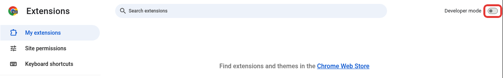
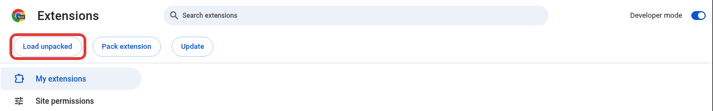
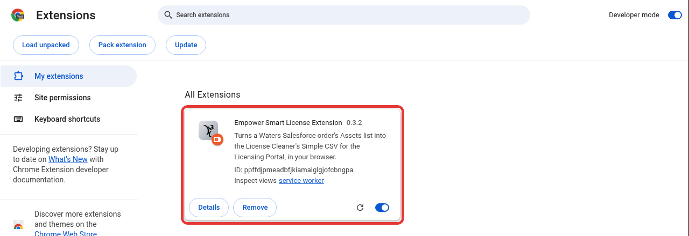
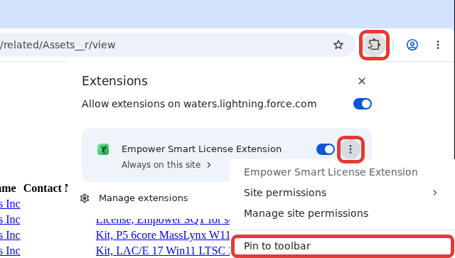
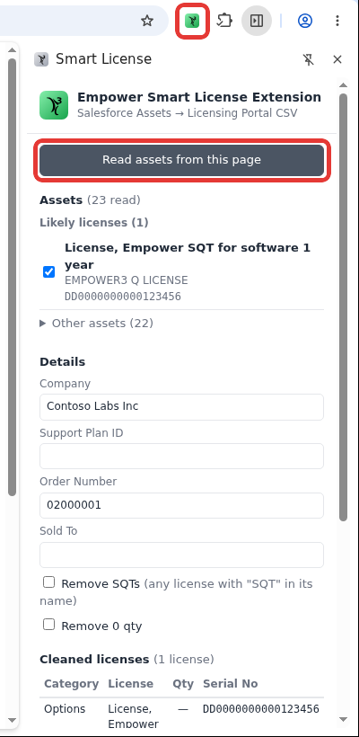
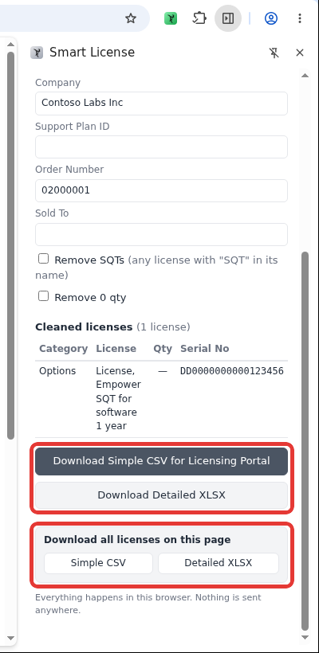

# Empower Smart License Extension

This repository has the **source, downloads and issue tracking** for Empower Smart License Extension, part of
the Empower Smart Tools family alongside
[Empower Smart License Cleaner](https://github.com/mattpetosa/empower-smart-license-cleaner),
[Empower Smart Deploy](https://github.com/mattpetosa/empower-smart-deploy-releases) and
[Empower Smart Project Mover](https://github.com/mattpetosa/empower-smart-project-mover-releases).
It is a Chrome extension that turns a Waters Salesforce order's **Assets** list into the
License Cleaner's **Simple CSV for Licensing Portal** (and the Detailed XLSX), without copying
serials by hand.

**[⬇ Download the latest release](https://github.com/mattpetosa/empower-smart-license-extension/releases)**: the `EmpowerSmartLicenseExtension_vX.Y.Z.zip` file.

## What it does

- **Reads the order's Assets list.** It reads every asset row on the page, including the ones
  Salesforce only loads as you scroll.
- **Picks out the licenses.** Rows that look like licenses are ticked; hardware goes under
  **Other assets**. Tick or untick anything that's wrong.
- **Fills in the details.** Company, Order Number and Support Plan ID come from the page.
- **Cleans them with the License Cleaner's own rules** and downloads the Simple CSV for the
  Licensing Portal or the categorized Detailed XLSX.
- **Handles orders with several environments** (Prod / Dev / Test): one colour, Support Plan ID
  and file per environment.

Everything happens in your browser. The extension makes no network requests, so serials never
leave your PC. It can only read pages on `waters.lightning.force.com`.

## Install (one time)

The extension isn't on the Chrome Web Store, so Chrome loads it from a folder in
**Developer mode**. It takes about a minute.

### 1. Unzip it somewhere permanent

Download `EmpowerSmartLicenseExtension_vX.Y.Z.zip` from the
[Releases](https://github.com/mattpetosa/empower-smart-license-extension/releases) page,
right-click it → **Extract All…**, and extract it to a folder you'll keep, for example
`Documents\EmpowerSmartLicenseExtension`. Chrome loads the extension from that folder every time
it starts, so don't delete or move it afterwards.

### 2. Turn on Developer mode

Type `chrome://extensions` in the address bar and press Enter. Turn on **Developer mode** (top right).

If the switch is greyed out, your Chrome is managed and blocks this; ask your IT admin.

### 3. Click Load unpacked

Three buttons appear. Click **Load unpacked**.

In the folder window, open the folder you extracted and select the
**`EmpowerSmartLicenseExtension_vX.Y.Z`** folder: the one with `manifest.json` inside it.
Then click **Select Folder**.

### 4. Check it loaded

**Empower Smart License Extension** now shows under **All Extensions**, switched on.

### 5. Pin it to the toolbar

Click the puzzle-piece icon in the toolbar, then **⋮** next to Empower Smart License Extension,
then **Pin to toolbar**. (Some Chrome versions show a pin icon right in that list instead; click it.)
If the list shows **Allow extensions on waters.lightning.force.com**, leave it switched on.

The icon stays in the toolbar. It's **grey** on most pages and turns **green** on an order's
Assets list, where it can read the page.

## Use

1. In Salesforce, open the order → **Related** → **Assets** → **View All**.
2. Click the green extension icon. A side panel opens. Click **Read assets from this page**.
3. Check the ticked licenses and the details (Company, Support Plan ID, Order Number; add Sold To
   if you want it in the file name). The Support Plan ID is the serial of the
   **S/W Benefits Info** row.

   

4. Click **Download Simple CSV for Licensing Portal** and upload it to the Waters Licensing
   Portal. **Download Detailed XLSX** gives the categorized workbook.
   **Download all licenses on this page** reads the list and downloads every likely license in
   one file straight away, with no Read click needed.

   

**Orders with several environments** (several S/W Benefits Info rows): each environment gets a
colour and a number, and nothing is pre-ticked, because Salesforce doesn't say which license
belongs where. Click **1**, **2** or **3** on each license to put it in that environment, then use
each environment's own download buttons.

*Screenshots are from a test page with made-up data. Your Chrome may look slightly different.*

## Update

Download the new zip, replace the contents of your extension folder with the new zip's contents,
then click the reload icon (↻) on the extension's card in `chrome://extensions`. Your version
number shows on that card. What changed in each version is in [RELEASES.md](RELEASES.md).

## Building from source

- `npm install`, then `npm test` (unit tests, jsdom) and `npm run smoke` (real Chromium with the
  unpacked extension against a synthetic Assets page).
- `scripts/build.sh` runs both and writes `dist/EmpowerSmartLicenseExtension_vX.Y.Z.zip`.
- `vendor/core.js` is a byte-for-byte copy of the
  [License Cleaner](https://github.com/mattpetosa/empower-smart-license-cleaner)'s `offline/core.js`
  (source commit in `vendor/CORE_SOURCE`). After a rule change there, run `scripts/sync-core.sh`
  (expects a Cleaner checkout at `~/licenses-site` or `$ESLC_SITE`) and bump the version.
- Test fixtures are synthetic. Never commit a real Salesforce page (`real-pages/` is gitignored).

## Issues

Found a problem? [Open an issue](https://github.com/mattpetosa/empower-smart-license-extension/issues).
Please don't attach real Salesforce pages or customer serials.
